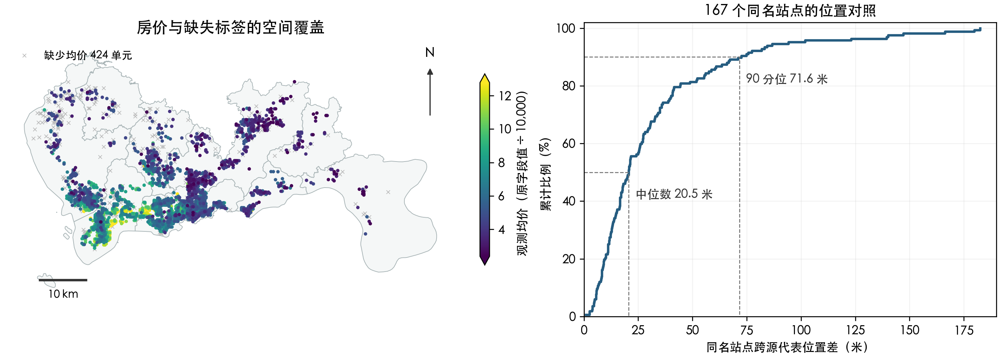
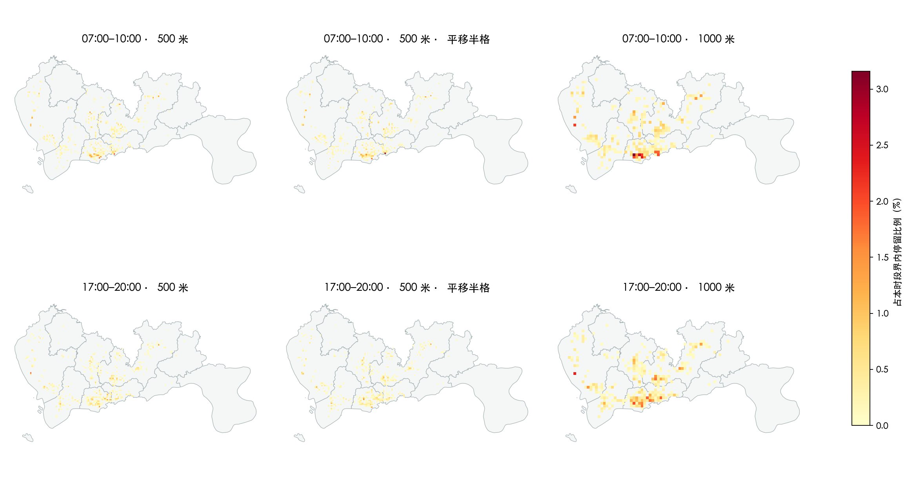

# 深圳房价预测与出租车轨迹分析

深圳大学《地理空间智能导论》个人课程项目。项目比较同城空间留出条件下的房价预测方法，并从出租车 GPS 记录提取停留窗口和候选 OD，分析分时空间分布及其对处理规则的敏感性。

这份仓库公开分析代码、汇总图表、实际复核日志和复现步骤。课程原始数据与逐车轨迹明细留在本地；使用课程数据的读者可按下面步骤重新生成详细结果。纸质／PDF 报告按课程渠道提交，仓库作为过程证据入口。

## 查看结果

| 内容 | 入口 |
|---|---|
| 实验如何完成，何时归档 | [项目日志](docs/实验日志.md) |
| AI 使用与研究判断 | [AI 辅助过程](docs/AI辅助过程.md) |
| 数据如何准备与复现 | [复现说明](docs/复现说明.md) |
| 房价模型指标 | [两种空间切分汇总](分析结果/任务一_房价/扩展模型_空间验证.csv) |
| 出租车数据质量与筛选 | [轨迹质量审计](分析结果/任务二_轨迹/轨迹数据审计.csv)、[候选 OD 筛选](分析结果/任务二_轨迹/候选OD诊断.csv) |
| 11 月 19 日实际复核日志 | [房价](核查复核/证据/房价复跑日志.txt)、[轨迹](核查复核/证据/轨迹复跑日志.txt)、[空间位置](核查复核/证据/空间位置复核日志.txt) |

## 主要结果

房价数据包含 2,790 个空间单元，其中 2,366 个有均价。采用东西、南北两个方向的空间五折，并剔除距测试点不足 500 m 的训练点。

| 模型 | 东西 MAE | 南北 MAE | 东西 R² | 南北 R² |
|---|---:|---:|---:|---:|
| 线性回归 | 19,258 | 19,730 | −0.013 | −0.007 |
| 四设施 XGBoost | 18,835 | 18,181 | 0.051 | 0.118 |
| GWR | 16,548 | 15,331 | 0.254 | 0.350 |
| XGBoost＋投影坐标 | 14,095 | 13,658 | 0.402 | 0.439 |

误差沿用原始价格字段单位。坐标增强用于检验同城区位信息的预测收益；这些分数不代表跨城市泛化或设施的因果效应。对 121 个价格汇总疑点单元另做了排除对照，详见[补充指标](核查复核/证据/复跑与排除疑点房价指标.csv)。



轨迹输入为 400 辆车的 3,759,550 条观测。主规则保留 3,699,628 点，形成 71,188 个片段，识别 6,108 个停留窗口；暂定状态 1 为载客时提取 9,195 对候选 OD。反向编码为 8,385 对，严格联合规则为 5,869 对。



## 如何理解这些发现

- 随机划分的误差低于空间留出，说明评价结果依赖使用场景。空间邻近信息能够帮助预测，但不能替代对设施机制的识别。
- 分区地铁距离关系随纳入样本改变，尤其南山方向不稳定。不同训练折的 SHAP 基准不能直接当作同一地区效应比较。
- 日期和载客编码未获原始元数据确认。停留和候选 OD 均依赖时钟可比较的假设，不能据此估计全市真实客流、需求或运营日规律。
- 停留最高格会随格网原点改变。这里的热点是描述性高值，未进行显著性热点检验；跨尺度事件比例也不等于单位面积密度。

## 复现

Python 3.11，主要依赖版本已固定。将从课程授权渠道获得的数据解压到 `data/raw/`，不要将原始压缩包或详细轨迹提交到仓库。

```bash
python -m venv .venv
source .venv/bin/activate
python -m pip install -r requirements.txt
python run_analysis.py --list
python run_analysis.py --data data/raw --task all
```

Windows 激活环境使用 `.venv\Scripts\activate`。只运行房价或轨迹可选择 `--task housing` 或 `--task taxi`。新结果默认写入不跟踪的 `local_runs/results/`，保留运行日志。

无需原始数据即可检查公开的汇总结果：

```bash
python scripts/verify_results.py
```

该检查验证指标的一致性、记录／行程数量守恒、比例分母及归档边界，不等于重新完成数据语义核实或模型训练。

## 版本与来源

历史实验发生于 2026-11-18，独立复核发生于 2026-11-19；2026-11-23 整理并首次上传 GitHub。Git 提交时间从公开归档开始，未补造历史提交。归档的旧日志保留原内容，[数据包指纹](data/source_manifest.json)仅用于核对本地输入。

代码采用 MIT 许可证。课程数据不随仓库发布；本许可证不授予任何第三方数据的使用或再分发权。主要方法来源见[参考文献](docs/参考文献.md)。
